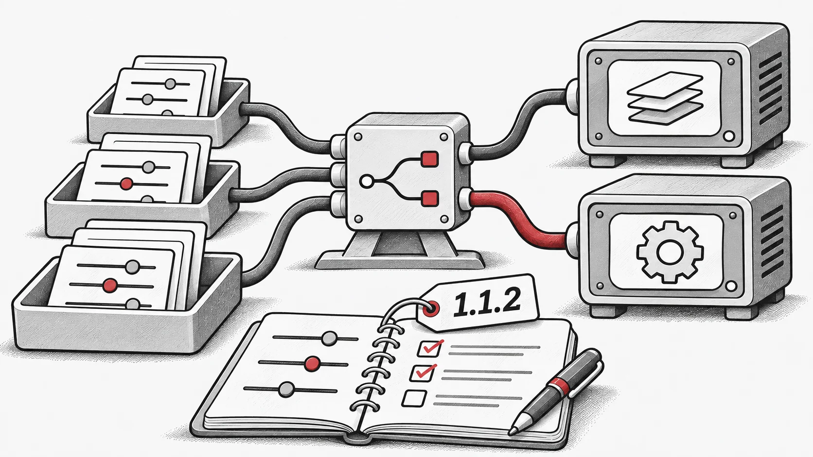

## 変更点
- 使用上の注意とパラメータチューニングのガイダンスを追加し、ドキュメントを更新しました

- `vmap` およびハイパーパラメータ最適化 (HPO) に関連する新機能の追加と、バグ修正を行いました

- ドキュメントの様々な問題を修正しました

- ベンチマークコードにおけるいくつかのバグを解決しました

- 分散ワークフローの初期サポートを導入しました！

- 完全な変更ログ: [https://github.com/EMI-Group/evox/compare/v1.1.1...v1.1.2](https://github.com/EMI-Group/evox/compare/v1.1.1...v1.1.2 "https://github.com/EMI-Group/evox/compare/v1.1.1...v1.1.2")

## 関連資料

- [GitHub](https://github.com/EMI-Group/evox)
- [ドキュメント](https://evox.readthedocs.io/en/latest/)
