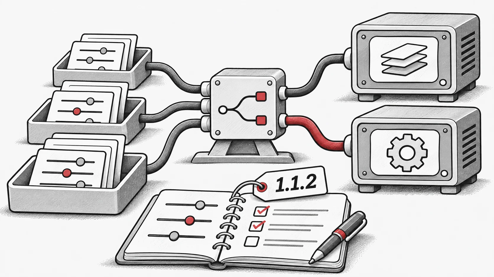

## 변경 사항
- 사용법 노트와 파라미터 튜닝 가이드를 포함하여 문서를 업데이트했습니다.

- `vmap` 및 하이퍼파라미터 최적화(HPO)와 관련된 새로운 기능을 추가하고 버그를 수정했습니다.

- 다양한 문서 문제를 수정했습니다.

- 벤치마킹 코드의 여러 버그를 해결했습니다.

- 분산 워크플로우에 대한 초기 지원을 도입했습니다!

- 전체 변경 로그: [https://github.com/EMI-Group/evox/compare/v1.1.1...v1.1.2](https://github.com/EMI-Group/evox/compare/v1.1.1...v1.1.2 "https://github.com/EMI-Group/evox/compare/v1.1.1...v1.1.2")

## 관련 자료

- [GitHub](https://github.com/EMI-Group/evox)
- [문서](https://evox.readthedocs.io/en/latest/)
