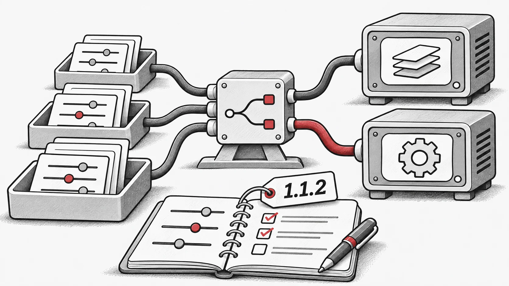

## O que mudou
- Documentação atualizada com notas de utilização e orientações para ajuste de parâmetros

- Adicionadas novas funcionalidades relacionadas com `vmap` e otimização de hiperparâmetros (HPO), juntamente com correções de erros

- Corrigidos vários problemas na documentação

- Resolvidos diversos erros no código de benchmarking

- Introduzido suporte inicial para fluxos de trabalho distribuídos!

- Changelog completo: [https://github.com/EMI-Group/evox/compare/v1.1.1...v1.1.2](https://github.com/EMI-Group/evox/compare/v1.1.1...v1.1.2 "https://github.com/EMI-Group/evox/compare/v1.1.1...v1.1.2")

## Recursos

- [GitHub](https://github.com/EMI-Group/evox)
- [Documentação](https://evox.readthedocs.io/en/latest/)
