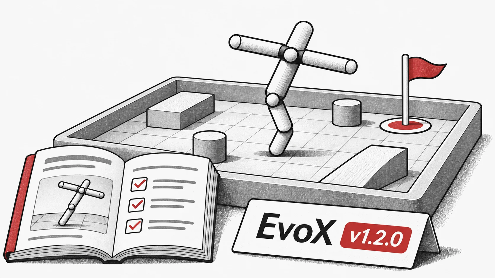

**Nous sommes ravis d'annoncer la sortie d'« EvoX v1.2.0 », remplie de nouvelles fonctionnalités, d'améliorations et de corrections de bugs importantes !**

**Cette mise à jour améliore la flexibilité et les performances du framework à travers des modules clés**.

## Points forts
-  Ajout de `final_step()` et mise à jour de `hpo_wrapper` et `std_workflow` pour des flux d'exécution plus fluides.

-  Introduction du « Mujoco Playground » -- un nouvel environnement pour les expériences d'apprentissage par renforcement.

-  Publication d'un tout nouveau [tutoriel](https://evox.readthedocs.io/en/latest/tutorial/ "https://evox.readthedocs.io/en/latest/tutorial/") pour aider les utilisateurs à se familiariser rapidement.

-  Ajout de nouvelles fonctions d'extension EvoX, permettant une meilleure intégration avec des projets frères comme [EvoMO](https://github.com/EMI-Group/evomo/ "https://github.com/EMI-Group/evomo/").

-  Diverses corrections de bugs et mises à jour de la documentation pour une meilleure stabilité et clarté.

## Pull Requests associées
- Mises à jour des docstrings pour les MOEA -- [#230](https://github.com/EMI-Group/evox/pull/230) (@Zhenyu2Liang)

- Correction de `vmap` dans `hpo_wrapper.py` -- [#232](https://github.com/EMI-Group/evox/pull/232) (@starquakee)

-  Ajout de RVEAa et amélioration du support de DTLZ, IGD, RVEA -- [#231](https://github.com/EMI-Group/evox/pull/231) (@XU-Boqing)

- Mises à jour de `final_step()` dans les modules de workflow -- [#233](https://github.com/EMI-Group/evox/pull/233) (@XU-Boqing)

-  Environnement Mujoco Playground -- [#234](https://github.com/EMI-Group/evox/pull/234) (@Nam-dada)

-  Améliorations de la documentation -- [#235](https://github.com/EMI-Group/evox/pull/235) (@Zhenyu2Liang)

-  Corrections de bugs pour Mujoco Playground -- [#236](https://github.com/EMI-Group/evox/pull/236) (@Nam-dada)

-  Nouveau tutoriel utilisateur -- [#237](https://github.com/EMI-Group/evox/pull/237) (@BillHuang2001)

**Journal des modifications complet** : [v1.1.2...v1.2.0](https://github.com/EMI-Group/evox/compare/v1.1.2...v1.2.0)

## Ressources

- [GitHub](https://github.com/EMI-Group/evox)
- [Documentation](https://evox.readthedocs.io/en/latest/)
