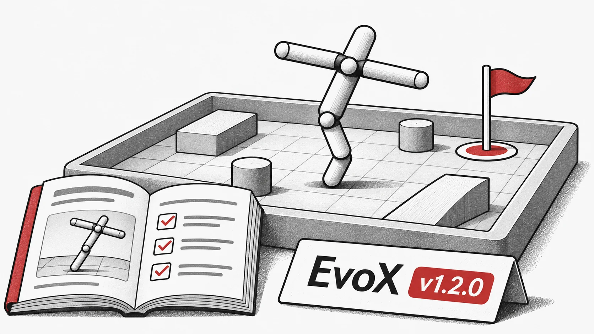

**Temos o prazer de anunciar o lançamento do "EvoX v1.2.0", repleto de novos recursos, melhorias e correções de bugs importantes!**

**Esta atualização aprimora a flexibilidade e o desempenho do framework em módulos-chave.**

## Destaques
-  Adicionado `final_step()` e atualizados `hpo_wrapper` e `std_workflow` para fluxos de execução mais fluidos.

-  Introduzido o "Mujoco Playground" — um novo ambiente para experimentos de aprendizado por reforço.

-  Lançado um novo [tutorial](https://evox.readthedocs.io/en/latest/tutorial/ "https://evox.readthedocs.io/en/latest/tutorial/") para ajudar os usuários a começarem rapidamente.

-  Adicionadas novas funções de extensão do EvoX, permitindo uma melhor integração com projetos irmãos como o [EvoMO](https://github.com/EMI-Group/evomo/ "https://github.com/EMI-Group/evomo/").

-  Várias correções de bugs e atualizações de documentação para melhor estabilidade e clareza.

## Pull Requests Relacionados
- Atualizações de docstring para MOEAs — [#230](https://github.com/EMI-Group/evox/pull/230) (@Zhenyu2Liang)

- Correção de `vmap` em `hpo_wrapper.py` — [#232](https://github.com/EMI-Group/evox/pull/232) (@starquakee)

- Adicionado RVEAa e suporte aprimorado para DTLZ, IGD, RVEA — [#231](https://github.com/EMI-Group/evox/pull/231) (@XU-Boqing)

- Atualizações de `final_step()` em módulos de workflow — [#233](https://github.com/EMI-Group/evox/pull/233) (@XU-Boqing)

- Ambiente Mujoco Playground — [#234](https://github.com/EMI-Group/evox/pull/234) (@Nam-dada)

- Refinamentos na documentação — [#235](https://github.com/EMI-Group/evox/pull/235) (@Zhenyu2Liang)

- Correções de bugs para o Mujoco Playground — [#236](https://github.com/EMI-Group/evox/pull/236) (@Nam-dada)

- Novo tutorial para o usuário — [#237](https://github.com/EMI-Group/evox/pull/237) (@BillHuang2001)

**Changelog Completo**: [v1.1.2...v1.2.0](https://github.com/EMI-Group/evox/compare/v1.1.2...v1.2.0)

## Recursos

- [GitHub](https://github.com/EMI-Group/evox)
- [Documentação](https://evox.readthedocs.io/en/latest/)
