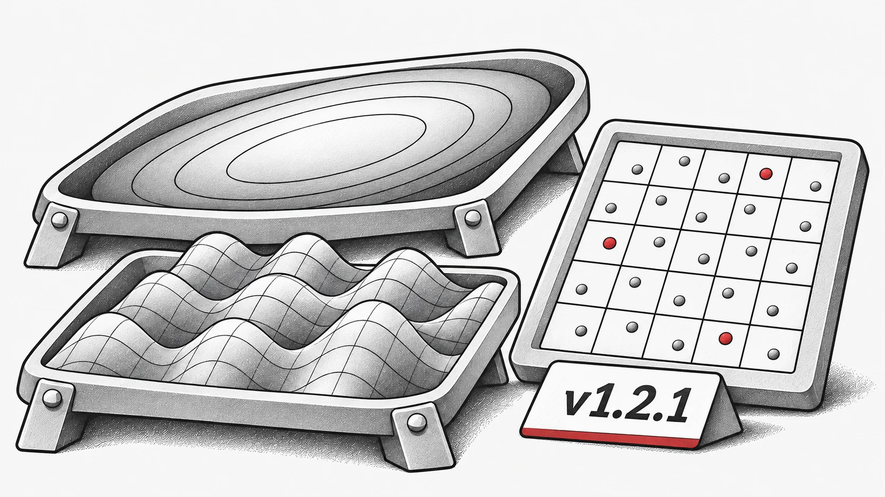

Dies ist ein kleineres Release, das sich auf die Verbesserung der Stabilität und die Behebung von Fehlern konzentriert, mit einigen Komfortverbesserungen.

## Neue Funktionen
Neue Benchmark-Funktionen: Numerische Single-Objective-Funktionen hinzugefügt: `Ellipsoid` und `Griewank`.

## Fehlerbehebungen
* Ein Problem wurde behoben, bei dem `StdWorkflow` nicht mit Algorithmen funktionierte, die von anderen Algorithmen erben.

* Ein Fehler in der Funktion `latin_hypercube_sampling_standard` wurde korrigiert.

* Ein Problem wurde gelöst, bei dem `non_dominate` unter `torch.compile` fehlschlug.

* Ein Problem wurde korrigiert, bei dem `PSO` in bestimmten Fällen das Standardgerät (Default Device) nicht korrekt verwendete.

## Refactoring & Wartung
* Häufig verwendete Utilities wurden der Einfachheit halber auf die oberste Ebene re-exportiert, zum Beispiel:

  * `evox.compile` anstelle von `evox.core.compile`

  * `evox.vmap` anstelle von `evox.core.vmap`.

* Veralteter oder redundanter Code wurde entfernt.

Vollständiges Änderungsprotokoll: [https://github.com/EMI-Group/evox/compare/v1.2.0...v1.2.1](https://github.com/EMI-Group/evox/compare/v1.2.0...v1.2.1 "https://github.com/EMI-Group/evox/compare/v1.2.0...v1.2.1")

## Ressourcen

- [GitHub](https://github.com/EMI-Group/evox)
- [Dokumentation](https://evox.readthedocs.io/en/latest/)
