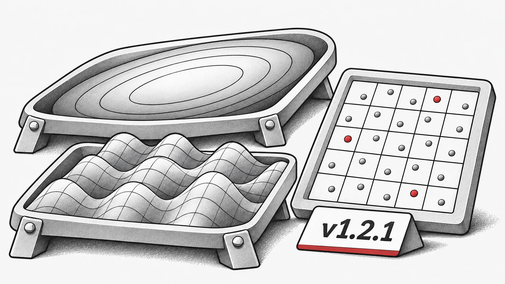

Esta es una versión menor enfocada en mejorar la estabilidad y corregir errores, con algunas mejoras en la calidad de vida del usuario.

## Nuevas características
Nuevas funciones de benchmark: Se agregaron funciones numéricas de un solo objetivo: `Ellipsoid` y `Griewank`.

## Correcciones de errores
* Se corrigió un problema donde `StdWorkflow` no funcionaba con algoritmos que heredan de otros algoritmos.

* Se corrigió un error en la función `latin_hypercube_sampling_standard`.

* Se resolvió un problema con `non_dominate` que fallaba bajo `torch.compile`.

* Se corrigió un problema donde `PSO` no utilizaba el dispositivo predeterminado correctamente en ciertos casos.

## Refactorización y mantenimiento
* Se volvieron a exportar utilidades de uso común al nivel superior para mayor comodidad, por ejemplo:

  * `evox.compile` en lugar de `evox.core.compile`

  * `evox.vmap` en lugar de `evox.core.vmap`.

* Se eliminó código obsoleto o redundante.

Registro de cambios completo: [https://github.com/EMI-Group/evox/compare/v1.2.0...v1.2.1](https://github.com/EMI-Group/evox/compare/v1.2.0...v1.2.1 "https://github.com/EMI-Group/evox/compare/v1.2.0...v1.2.1")

## Recursos

- [GitHub](https://github.com/EMI-Group/evox)
- [Documentación](https://evox.readthedocs.io/en/latest/)
