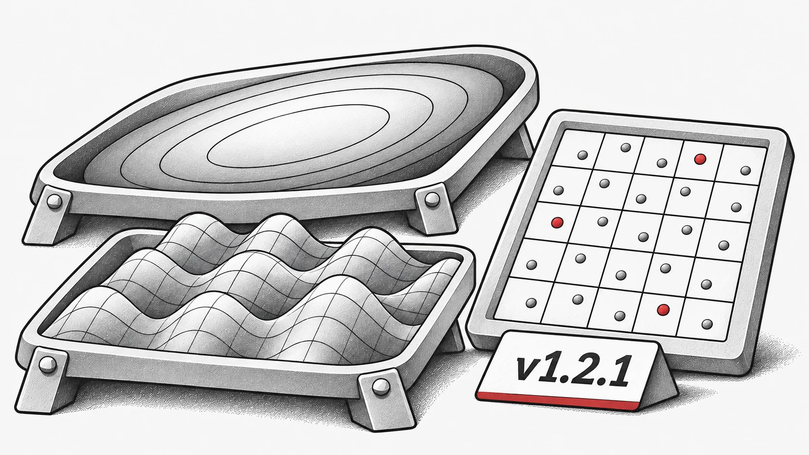

Este é um lançamento menor focado em melhorar a estabilidade e corrigir bugs, com algumas melhorias de qualidade de vida.

## Novos Recursos
Novas Funções de Benchmark: Adicionadas funções numéricas de objetivo único: `Ellipsoid` e `Griewank`.

## Correções de Bugs
* Corrigido um problema onde o `StdWorkflow` falhava ao funcionar com algoritmos que herdam de outros algoritmos.

* Corrigido um bug na função `latin_hypercube_sampling_standard`.

* Resolvido um problema com o `non_dominate` falhando sob o `torch.compile`.

* Corrigido um problema onde o `PSO` não usava o dispositivo padrão adequadamente em certos casos.

## Refatoração e Manutenção
* Re-exportação de utilitários comumente usados para o nível superior por conveniência, por exemplo:

  * `evox.compile` em vez de `evox.core.compile`

  * `evox.vmap` em vez de `evox.core.vmap`.

* Removido código depreciado ou redundante.

Changelog Completo: [https://github.com/EMI-Group/evox/compare/v1.2.0...v1.2.1](https://github.com/EMI-Group/evox/compare/v1.2.0...v1.2.1 "https://github.com/EMI-Group/evox/compare/v1.2.0...v1.2.1")

## Recursos

- [GitHub](https://github.com/EMI-Group/evox)
- [Documentação](https://evox.readthedocs.io/en/latest/)
