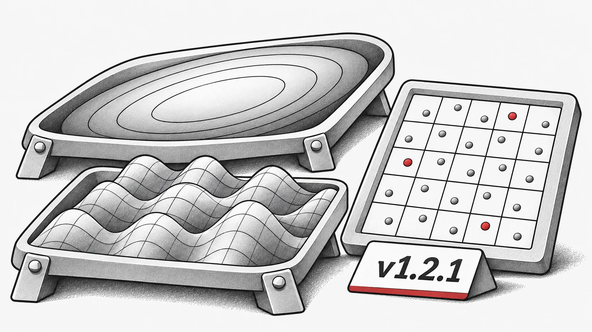

这是一个专注于提升稳定性并修复 Bug 的小版本更新，同时包含了一些易用性改进。

## 新特性
新增基准测试函数：添加了单目标数值函数 `Ellipsoid` 和 `Griewank`。

## Bug 修复
* 修复了 `StdWorkflow` 无法与继承自其他算法的算法正常工作的问题。

* 修正了 `latin_hypercube_sampling_standard` 函数中的一个 Bug。

* 解决了 `non_dominate` 在 `torch.compile` 下运行失败的问题。

* 修正了 `PSO` 在某些情况下未能正确使用默认设备的问题。

## 重构与维护
* 为方便使用，将常用工具重新导出到了顶层，例如：

* 使用 `evox.compile` 代替 `evox.core.compile`

* 使用 `evox.vmap` 代替 `evox.core.vmap`。

* 移除了已弃用或冗余的代码。

完整变更日志：[https://github.com/EMI-Group/evox/compare/v1.2.0...v1.2.1](https://github.com/EMI-Group/evox/compare/v1.2.0...v1.2.1 "https://github.com/EMI-Group/evox/compare/v1.2.0...v1.2.1")

## 相关资源

- [GitHub](https://github.com/EMI-Group/evox)
- [文档](https://evox.readthedocs.io/en/latest/)
