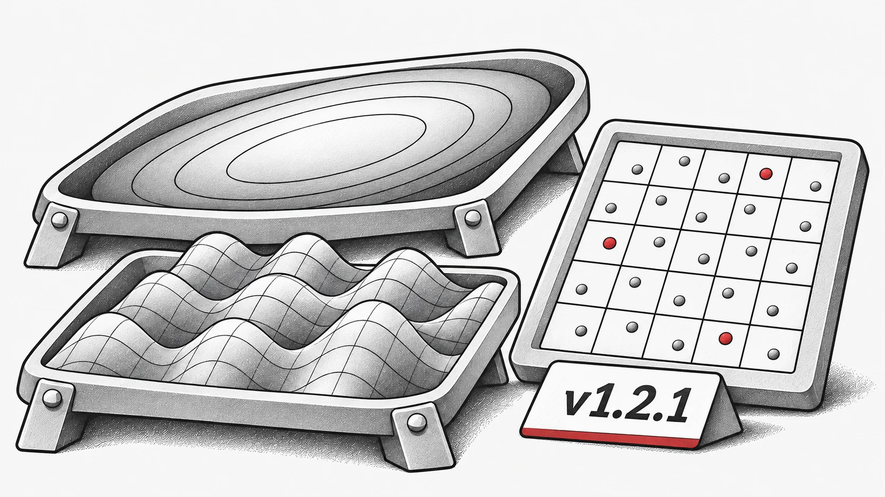

這是一個次要版本，專注於提升穩定性並修復錯誤，同時包含了一些使用體驗上的改進。

## 新功能
新增基準測試函數：添加了單目標數值函數：`Ellipsoid` 和 `Griewank`。

## 錯誤修復
* 修復了 `StdWorkflow` 無法與繼承自其他演算法的演算法一起運作的問題。

* 修正了 `latin_hypercube_sampling_standard` 函數中的一個錯誤。

* 解決了 `non_dominate` 在 `torch.compile` 下失敗的問題。

* 修正了 `PSO` 在某些情況下未能正確使用預設裝置的問題。

## 重構與維護
* 為了方便起見，將常用的工具重新導出到頂層，例如：

* 使用 `evox.compile` 代替 `evox.core.compile`

* 使用 `evox.vmap` 代替 `evox.core.vmap`。

* 移除了已棄用或多餘的程式碼。

完整變更日誌：[https://github.com/EMI-Group/evox/compare/v1.2.0...v1.2.1](https://github.com/EMI-Group/evox/compare/v1.2.0...v1.2.1 "https://github.com/EMI-Group/evox/compare/v1.2.0...v1.2.1")

## 相關資源

- [GitHub](https://github.com/EMI-Group/evox)
- [文件](https://evox.readthedocs.io/en/latest/)
