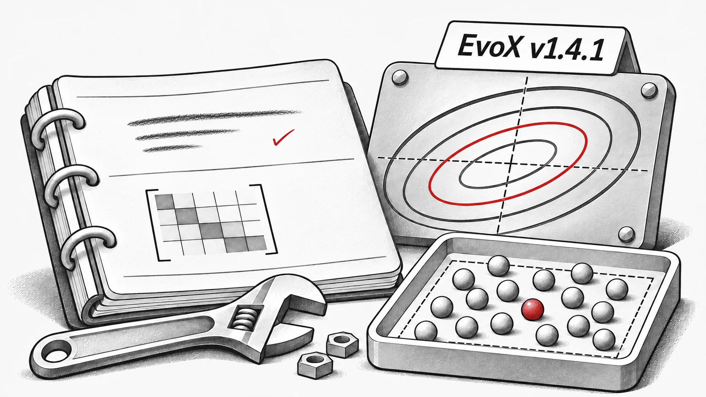

**EvoX v1.4.1** corregge errori algoritmici e problemi di esecuzione nella serie stabile 1.x.

## Correzioni agli algoritmi

- **CMA-ES:** corretti l’aggiornamento di rango uno della covarianza e la costante di accumulazione `c_c`; risolto un arresto anomalo in `torch.cond` e riattivato il test ([#251](https://github.com/EMI-Group/evox/pull/251), [#255](https://github.com/EMI-Group/evox/pull/255), [#256](https://github.com/EMI-Group/evox/pull/256)).
- **Varianti DE:** campionamento di `DE_binary_crossover` cambiato da distribuzione normale a uniforme. Corretti l’adattamento di `F` e `CR` in SHADE e il campionamento entro i limiti delle popolazioni iniziali delle varianti DE ([#252](https://github.com/EMI-Group/evox/pull/252), [#258](https://github.com/EMI-Group/evox/pull/258)).
- **PSO:** corretto il trasferimento dei limiti al dispositivo ([#253](https://github.com/EMI-Group/evox/pull/253)).
- **Strategie evolutive:** corretti ASEBO dopo l’attivazione del sottospazio del gradiente, il `pop_size` predefinito di XNES/SeparableNES e gli arresti legati ai sottospazi di Guided ES ([#257](https://github.com/EMI-Group/evox/pull/257), [#259](https://github.com/EMI-Group/evox/pull/259)).

## Operatori e metriche

- Risolti gli arresti della selezione a torneo con `n_round=1` ([#259](https://github.com/EMI-Group/evox/pull/259)).
- L’ipervolume (`hv`) ora ignora i punti che non dominano il punto di riferimento ([#254](https://github.com/EMI-Group/evox/pull/254)).

Grazie a @bbopen, @raashish1601, @Arthur031221 e @flyingdoubleG per i loro primi contributi.

**Release**: [v1.4.1](https://github.com/EMI-Group/evox/releases/tag/v1.4.1) · **Registro completo delle modifiche**: [v1.4.0...v1.4.1](https://github.com/EMI-Group/evox/compare/v1.4.0...v1.4.1)
