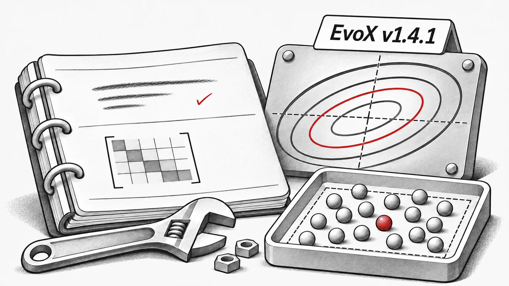

**EvoX v1.4.1**은 안정 버전인 1.x 계열에서 알고리즘 정확성과 실행 관련 문제를 수정합니다.

## 알고리즘 수정

- **CMA-ES:** 공분산의 랭크 1 갱신과 누적 상수 `c_c` 수정. `torch.cond`의 충돌을 수정하고 테스트를 다시 활성화 ([#251](https://github.com/EMI-Group/evox/pull/251), [#255](https://github.com/EMI-Group/evox/pull/255), [#256](https://github.com/EMI-Group/evox/pull/256)).
- **DE 변형:** `DE_binary_crossover`의 샘플링을 정규분포에서 균등분포로 변경. SHADE의 `F`, `CR` 적응을 수정하고 DE 변형의 초기 개체군을 경계 내에서 샘플링하도록 수정 ([#252](https://github.com/EMI-Group/evox/pull/252), [#258](https://github.com/EMI-Group/evox/pull/258)).
- **PSO:** 경계 텐서의 장치 전송 수정 ([#253](https://github.com/EMI-Group/evox/pull/253)).
- **진화 전략:** 기울기 부분공간 활성화 이후의 ASEBO 문제, XNES/SeparableNES의 기본 `pop_size` 문제 및 Guided ES 부분공간 충돌 수정 ([#257](https://github.com/EMI-Group/evox/pull/257), [#259](https://github.com/EMI-Group/evox/pull/259)).

## 연산자 및 지표

- `n_round=1`일 때 토너먼트 선택 충돌 수정 ([#259](https://github.com/EMI-Group/evox/pull/259)).
- 하이퍼볼륨(`hv`) 계산에서 기준점을 지배하지 않는 점을 제외 ([#254](https://github.com/EMI-Group/evox/pull/254)).

첫 기여를 해주신 @bbopen, @raashish1601, @Arthur031221, @flyingdoubleG에게 감사드립니다.

**릴리스**: [v1.4.1](https://github.com/EMI-Group/evox/releases/tag/v1.4.1) · **전체 변경 기록**: [v1.4.0...v1.4.1](https://github.com/EMI-Group/evox/compare/v1.4.0...v1.4.1)
