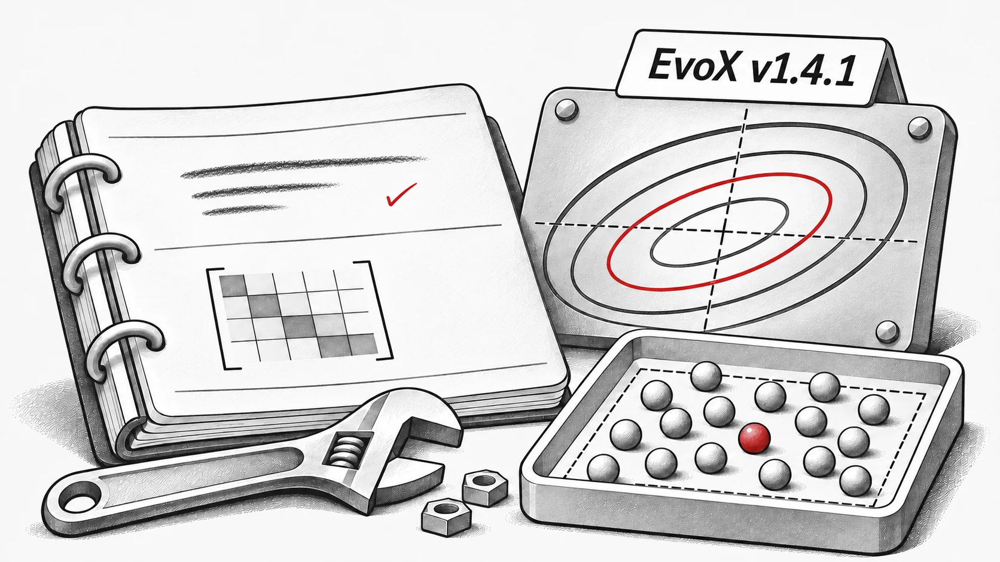

O **EvoX v1.4.1** corrige erros algorítmicos e de execução na série estável 1.x.

## Correções nos algoritmos

- **CMA-ES:** corrigidas a atualização de posto um da covariância e a constante de acumulação `c_c`; resolvida uma falha em `torch.cond` e reativado o teste ([#251](https://github.com/EMI-Group/evox/pull/251), [#255](https://github.com/EMI-Group/evox/pull/255), [#256](https://github.com/EMI-Group/evox/pull/256)).
- **Variantes DE:** alterada a amostragem de `DE_binary_crossover` de uma distribuição normal para uniforme. Corrigida a adaptação de `F` e `CR` no SHADE e a amostragem das populações iniciais das variantes DE dentro dos limites ([#252](https://github.com/EMI-Group/evox/pull/252), [#258](https://github.com/EMI-Group/evox/pull/258)).
- **PSO:** corrigida a transferência dos limites para o dispositivo ([#253](https://github.com/EMI-Group/evox/pull/253)).
- **Estratégias evolutivas:** corrigidos o ASEBO após ativação do subespaço do gradiente, o `pop_size` padrão de XNES/SeparableNES e as falhas dos subespaços de Guided ES ([#257](https://github.com/EMI-Group/evox/pull/257), [#259](https://github.com/EMI-Group/evox/pull/259)).

## Operadores e métricas

- Corrigidas falhas da seleção por torneio com `n_round=1` ([#259](https://github.com/EMI-Group/evox/pull/259)).
- O hipervolume (`hv`) passa a ignorar os pontos que não dominam o ponto de referência ([#254](https://github.com/EMI-Group/evox/pull/254)).

Obrigado a @bbopen, @raashish1601, @Arthur031221 e @flyingdoubleG por suas primeiras contribuições.

**Lançamento**: [v1.4.1](https://github.com/EMI-Group/evox/releases/tag/v1.4.1) · **Histórico completo**: [v1.4.0...v1.4.1](https://github.com/EMI-Group/evox/compare/v1.4.0...v1.4.1)
