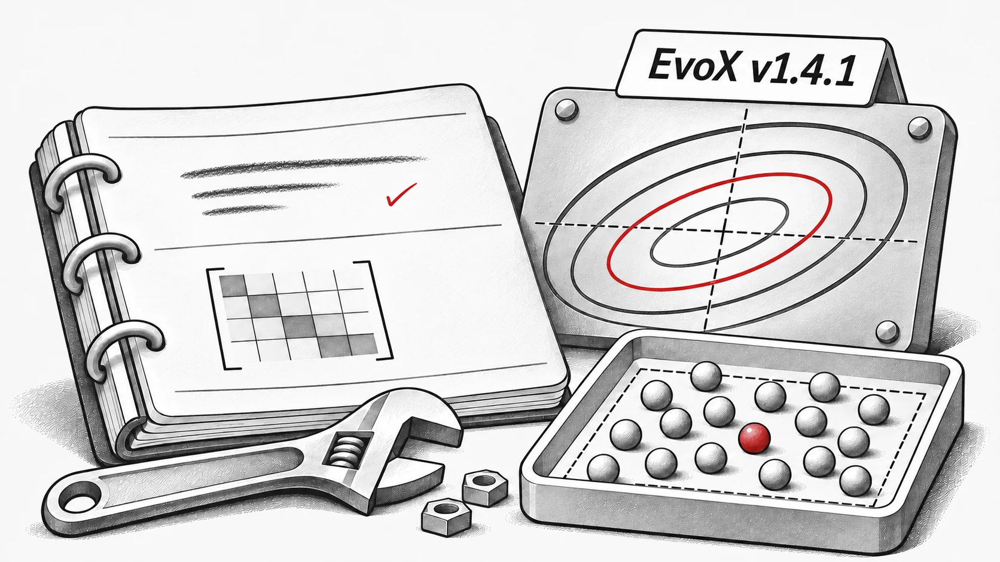

**EvoX v1.4.1** 修正穩定版 1.x 系列中的演算法正確性與執行問題。

## 演算法修正

- **CMA-ES：** 修正共變異數矩陣的秩一更新與累積常數 `c_c`；修正 `torch.cond` 中的當機並重新啟用測試 ([#251](https://github.com/EMI-Group/evox/pull/251), [#255](https://github.com/EMI-Group/evox/pull/255), [#256](https://github.com/EMI-Group/evox/pull/256)).
- **DE 變體：** 將 `DE_binary_crossover` 的取樣由常態分布改為均勻分布。修正 SHADE 的 `F`、`CR` 自適應機制，並確保 DE 變體的初始族群在邊界內取樣 ([#252](https://github.com/EMI-Group/evox/pull/252), [#258](https://github.com/EMI-Group/evox/pull/258)).
- **PSO：** 修正邊界張量的裝置轉移問題 ([#253](https://github.com/EMI-Group/evox/pull/253)).
- **演化策略：** 修正 ASEBO 在梯度子空間啟用後的問題、XNES/SeparableNES 的預設 `pop_size` 問題，以及 Guided ES 的子空間當機 ([#257](https://github.com/EMI-Group/evox/pull/257), [#259](https://github.com/EMI-Group/evox/pull/259)).

## 運算子與指標

- 修正 `n_round=1` 時競賽選擇的當機 ([#259](https://github.com/EMI-Group/evox/pull/259)).
- 超體積（`hv`）計算現在會忽略未支配參考點的點 ([#254](https://github.com/EMI-Group/evox/pull/254)).

感謝 @bbopen、@raashish1601、@Arthur031221 和 @flyingdoubleG 的首次貢獻。

**發布紀錄**: [v1.4.1](https://github.com/EMI-Group/evox/releases/tag/v1.4.1) · **完整變更紀錄**: [v1.4.0...v1.4.1](https://github.com/EMI-Group/evox/compare/v1.4.0...v1.4.1)
