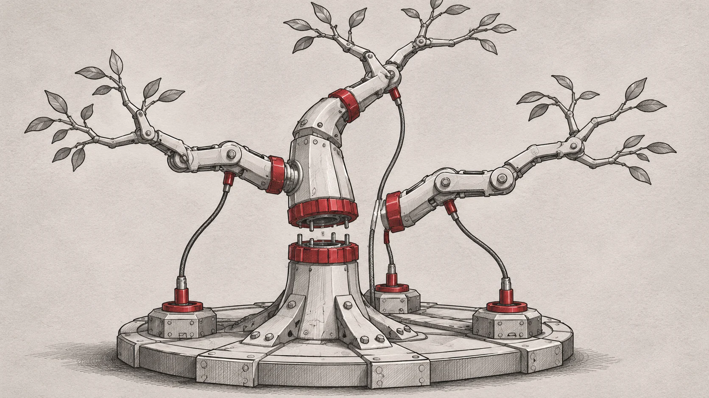

長時間開發任務需要的不只是重啟按鈕，還需要知道哪些智慧體正在工作、各自學到了什麼，以及究竟能恢復哪一份檔案狀態。[Genesis 0.14.3][release] 於 2026 年 11 月 19 日釋出，將任務級暫停與恢復、持久智慧體狀態、更清晰的實時活動，以及配置、審批和部署改進帶入同一版本。



*概念插畫：恢復任務，需要讓各分支重新接上自己的已儲存狀態。*

## 暫停一個任務，保留繼續工作的可能
執行中的任務可以從 `pausing` 進入 `paused`。智慧體完成正在執行的工具批次，為對話建立檢查點，並提交工作樹後再停止。已暫停的任務仍可見、可恢復，不會被記作完成或取消；恢復時沿用同一個任務 ID。

當多智慧體實現工作需要跨工作時段繼續時，這一區別很實用。保持任務的持久智慧體狀態選項開啟，發起暫停，並等待狀態變為已暫停後再認定工作已穩定儲存。持久化預設開啟，也可透過 `genesis_start_task` 的 `persistent_state` 控制。互動會話不能暫停，關閉持久化的任務無法恢復。[版本化實現][pause] 還要求存在根智慧體的持久記錄，僅有子智慧體記錄不足以重新啟動目標。
## 恢復整棵樹，明確檔案狀態邊界
獨立 SQLite 儲存儲存每個智慧體的對話、執行身份，以及工具和子智慧體批次進度。整樹恢復時，已完成的子智慧體提供已儲存結果；仍在執行的子智慧體從各自的持久檢查點和工作樹基點繼續。穩定的智慧體 ID 保留這些關聯；身份已被佔用時，系統會警告並採用回退方式。

`refs/genesis/agent-state` 下的 Git 引用讓檢查點提交在工作分支被回收後仍保持可達。正常暫停可從記錄的暫停提交重建工作樹。意外中斷後，[恢復提示][notice] 會指出有保證的檢查點：被終止執行中的未提交修改不保證保留。如果沒有檢查點，提示會解釋回退到任務基點的情況。

若恢復的任務此前正在修改檔案和啟動作業，應先檢查提示中的提交、`git status` 和 `job_list`，再決定是否重複操作。中斷的工具呼叫得到的是修復資訊，不是虛構的成功結果。此版本也修復重複建立子智慧體、互動會話被錯誤恢復為異常暫停任務的問題，並改進回合上限恢復。
## 看見此前像是空閒的工作
檢查器和 Assistant 現在讀取實時活動及原子監視快照。上下文壓縮與下一回合準備有獨立的忙碌階段，不再顯示為空閒。Context Memory 將實時呼叫作為尾部行展示，歷史推理保持靜態。這讓使用者更容易理解安靜的等待時段，區分壓縮與請求停滯。

排程器擁有的工具許可限制併發呼叫，並在後臺交接期間保留所有權。被放棄的啟動請求會被拒絕，超時後的約束清理在工具任務停止前完成。後臺完成通知和作業系統狀態探測移出登錄檔的阻塞路徑；會話結束也避免同步持久化屏障。檢查點寫入器合併排隊工作，並限制積壓和載荷大小，避免儲存壓力拖住所有智慧體。
## 更明確的配置與審批
由模式定義的設定 API 支援部分更新，Assistant 可發現配置並以只讀方式查詢專案。審批對話方塊和通知展示請求身份、許可權及執行狀態。通知範圍、焦點處理、許可權提示和減少動態效果的行為均得到改進。

專案感知的 Assistant 會話也將隔離對話、上傳和任務跟蹤納入本版本；[專案工作流文章][workflow] 詳述了這些互動。顯式的本地技能清單命令可跳過工具許可權檢查，自動提交回退則處理智慧體遺漏提交或提交失敗的情況。
## 升級後檢查恢復結果
對於已有的無頭伺服器安裝，[版本化升級指南][update] 提供以下命令：
```bash
genesis update --check
genesis update
```
檢測到可用更新時，檢查命令以程式碼 10 退出。升級前先讓活動工作完成；升級器檢查伺服器活動、準備新版本、重啟並驗證健康狀態。在新版本中，正在暫停的任務仍會阻止升級，已暫停的任務可恢復且不阻止升級。Release 頁面提供 Linux x64、Linux ARM64 和 macOS ARM64 的全新伺服器安裝包。

資料庫升級現在使用常規遷移，不再要求獨立的歷史協調步驟。舊身份衝突透過增量協調處理，殘留或不完整遷移狀態會被拒絕。SQLite 修復路徑僅用於開發。未使用的恢復輔助函式和一個完成別名從公共 API 移除，自定義整合應核對這些移除項。

依賴更新包含 Plug 1.20.4 的 multipart 長度限制安全修復與 ReqLLM 1.31.0，Nix 依賴雜湊及預檢也已重新整理。升級後確認伺服器報告的版本和健康狀態，再嘗試一個小型持久任務：暫停、確認檢查點、恢復同一任務，並檢查子智慧體結果與活動標籤。處理部署相關遷移診斷時，可對照[完整發布說明][release]。

[release]: https://github.com/EMI-Group/genesis/releases/tag/v0.14.3
[pause]: https://github.com/EMI-Group/genesis/blob/v0.14.3/apps/evo_git/lib/evo_git/task_registry/pause.ex
[notice]: https://github.com/EMI-Group/genesis/blob/v0.14.3/apps/evo_git/lib/evo_git/agent/resume/notice.ex
[update]: https://github.com/EMI-Group/genesis/blob/v0.14.3/docs/server-update.md
[workflow]: /zh-tw/news/genesis-assistant-project-workflows

